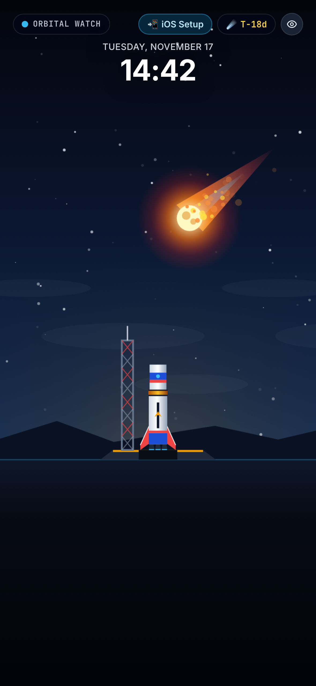
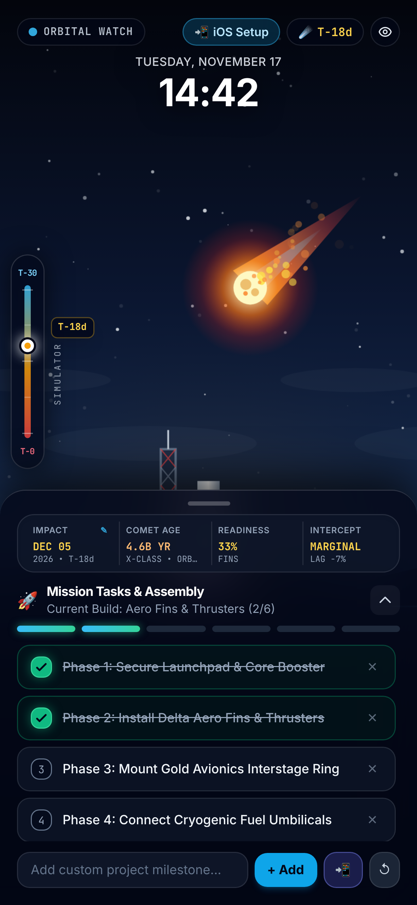

# Planetary Defense: Project Countdown

An interactive countdown lock screen that turns a project deadline into a mission to save Earth.

A comet closes in as the deadline approaches. Every milestone you check off builds another stage of the interceptor rocket. Finish them all and the rocket launches, destroys the comet, and leaves a peaceful sky as your wallpaper.

**Live demo:** https://cpt-marlow.github.io/planetary-defense-countdown/

  
  

## Features

- Set your real deadline (up to 30 days out) and the comet's approach follows it
- Six-stage rocket assembly driven by your own task list; add, remove and check off milestones
- Launch and intercept cutscene when every task is done
- Telemetry strip: impact date, readiness, and whether you are ahead of or behind schedule
- Exports a 1179×2556 iPhone lock screen PNG, with steps to automate it through Apple Shortcuts
- Time scrubber to preview any day of the countdown

## Run it

Open `index.html` in any browser. It is a single self-contained file with no build step and no network requests.
